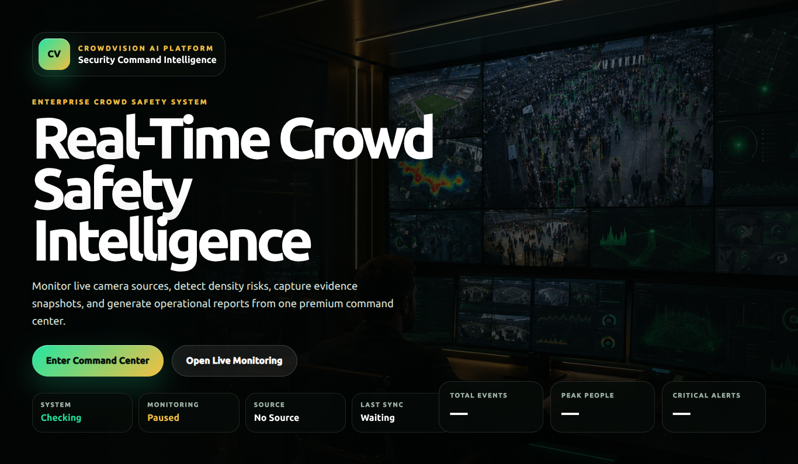
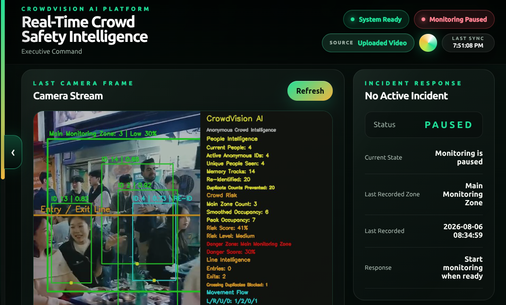
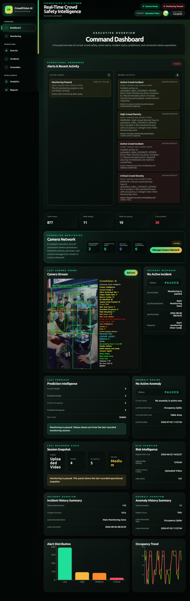
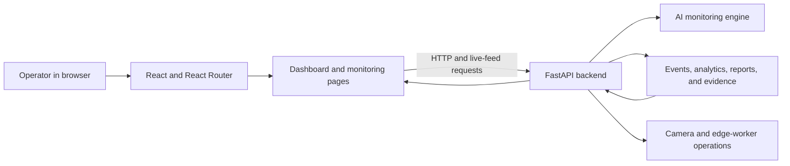

# CrowdVision AI Frontend

**A real-time web command center for AI-powered crowd monitoring and operational intelligence.**

The CrowdVision AI frontend is a React-based dashboard for viewing monitoring status, crowd metrics, camera health, incidents, anomalies, evidence, reports, analytics, and remote camera operations.

<p align="center">
  
</p>

## Product screenshots

The following screenshots show the CrowdVision AI interface from different views.

### Command Dashboard — Desktop View

<p align="center">
  
</p>

### Command Dashboard — Full-Page View

<p align="center">
  
</p>

## Project repositories

- **Frontend:** [crowdvision-frontend](https://github.com/promise-anyim/crowd-detection-fe)
- **Backend:** [crowdvision-backend](https://github.com/promise-anyim/crowd-detection-system-be)

## Overview

The frontend provides the operator-facing experience for CrowdVision AI. It communicates with the FastAPI backend, presents monitoring and analytics information, and provides controls for managing the monitoring engine and camera sources.

The interface is organized as a security command center, with a dashboard, live monitoring workspace, operational pages, and settings.

## Main areas

| Area | Purpose |
|---|---|
| Dashboard | System status, crowd metrics, alerts, camera information, and operational summaries |
| Live Monitoring | Monitoring view, engine controls, and current session information |
| Camera Sources | Manage camera profiles and local or remote camera sources |
| Incidents | Review recorded incidents |
| Anomalies | Review anomaly records and summaries |
| Analytics | Explore trends, charts, and crowd intelligence |
| Reports | Browse and preview generated reports |
| Evidence | Review available evidence records |
| Audit Log | Inspect recorded operational and security-related actions |
| Events | Review event history |
| Exports | Download supported CSV and Excel exports |
| Settings | Configure available application and monitoring options |

## Technology stack

- **React 19** — component-based user interface.
- **Vite 8** — development server and production build tooling.
- **React Router 6** — client-side navigation.
- **Recharts 3** — dashboard charts and data visualization.
- **CSS** — application layouts, responsive navigation, and visual styling.
- **Browser Fetch API** — communication with backend endpoints in the current implementation.

## Architecture



The frontend and backend are maintained in separate GitHub repositories and run as separate services during local development.

## Getting started

### Prerequisites

- Node.js version compatible with Vite 8.
- npm.
- The [CrowdVision AI backend](https://github.com/promise-anyim/crowd-detection-system-be) running locally.

### 1. Clone the frontend

```bash
git clone https://github.com/promise-anyim/crowd-detection-fe
cd crowdvision-frontend
```

### 2. Install dependencies

```bash
npm install
```

### 3. Start the development server

```bash
npm run dev
```

Vite prints the local development URL in the terminal. Open that URL in your browser.

**Backend connection:** Start the backend separately before using live dashboard data and monitoring controls. The current API base URL is defined in `src/config/constants.js` and defaults to:

```text
http://127.0.0.1:8000
```

This is the local-development configuration. A deployment using a backend on another host requires a corresponding API URL configuration.

## Available scripts

| Command | Description |
|---|---|
| `npm run dev` | Start the Vite development server |
| `npm run build` | Create the production frontend build in `dist/` |
| `npm run preview` | Preview the production build locally |
| `npm run lint` | Run ESLint checks |

To create a production build:

```bash
npm run build
```

## Project structure

```text
crowdvision-frontend/
├── index.html
├── package.json
├── vite.config.js
├── docs/
│   └── screenshots/
│       ├── landing-page.png
│       └── command-dashboard.png
└── src/
    ├── App.jsx
    ├── App.css
    ├── index.css
    ├── assets/
    ├── components/
    │   ├── camera/
    │   ├── charts/
    │   ├── common/
    │   ├── notifications/
    │   └── tables/
    ├── config/
    │   └── constants.js
    ├── layouts/
    ├── pages/
    ├── services/
    ├── styles/
    └── utils/
```

## Backend integration

The frontend consumes the FastAPI backend for:

- Health and dashboard summaries.
- Monitoring-engine status and controls.
- Live video and latest-frame delivery.
- Camera profiles and source management.
- Camera health and edge-worker status.
- Events, incidents, and anomalies.
- Analytics and prediction data.
- Reports, evidence, and exports.
- Notifications, Telegram status, and audit-log information.

The current implementation uses browser `fetch()` requests in the application and page components. The shared default API URL is held in `src/config/constants.js`.

## Related project

The API and computer-vision services are documented in the [CrowdVision AI Backend repository](https://github.com/promise-anyim/crowd-detection-system-be).

## Live Demo

Watch the [CrowdVision AI live demo](docs/demo/crowdvision-live-demo.mp4) to see the platform during crowd monitoring.
# crowd-detection-fe
# crowd-detection-fe
